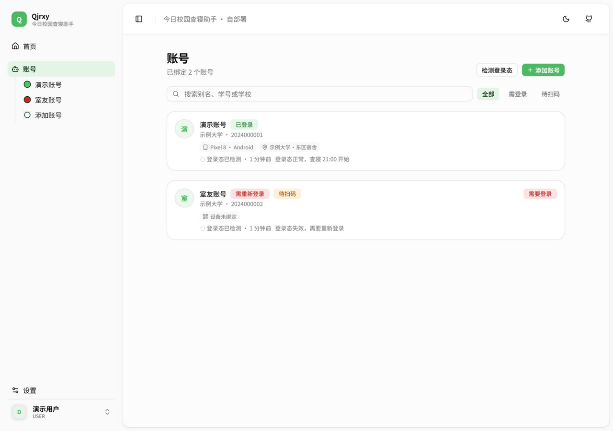
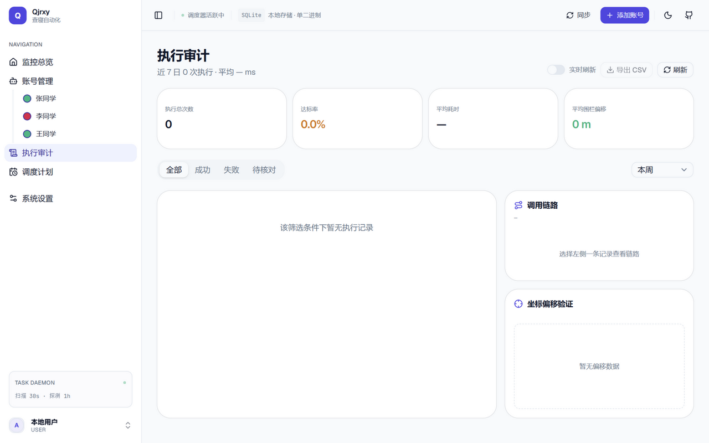
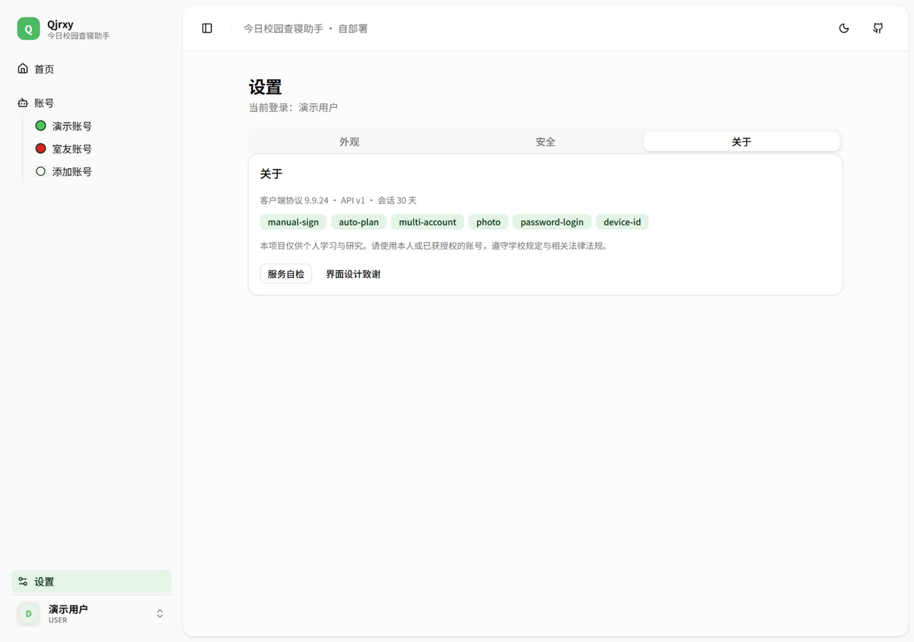

# Qjrxy

今日校园（Campusphere）查寝自动助手 —— 自部署单二进制工具。

支持密码、**短信验证码**或**扫码获取登录态**三种方式。托管认证（CLOUD）学校用账密/短信即可；学校自建统一身份认证（NOTCLOUD）可使用今日校园账号绑定手机号的短信验证码登录（首次未下发票据时自动补签），也可用「扫码登录」借 App 已登录的会话换出学校业务会话。绑定账号后，服务端会在查寝时间窗口内自动提交，会话过期自动恢复，全程无需打开 App。

> 本项目**只处理查寝任务**（宿舍考勤），二维码签到类任务不会执行。


## 界面

四个页面：**监控总览 / 账号管理 / 执行审计 / 调度计划**。

以下截图使用虚构的演示数据（示例大学 / 演示账号），不含任何真实账号信息。

| 账号管理 | 调度计划 |
| --- | --- |
|  |  |

| 执行详情 | 执行审计 |
| --- | --- |
|  |  |



## 功能

- **两种运行形态**
  - **单用户模式（默认）**：本地双击 exe 即用——自动打开浏览器、跳过登录、注册口关闭；API 仅建议在家庭网络使用
  - **多用户模式**：`QINGJIN_MULTI_USER=true` 恢复账号体系（登录 / 注册门 / 会话限流），服务器多人部署用
- **自动查寝** — 按计划的星期或**指定日期**与时段执行；任务未到时间自动等待，不产生无效提交
- **窗口驱动调度** — 同步一次任务后在本地计算唤醒时刻，不做高频轮询（每账号每天约 2 次请求）
- **短信验证码登录** — 基于今日校园账号体系，验证码渠道自适应（`CPDAILY` / `MOB`）；`sessionToken` 可长期续期
- **扫码获取登录态** — 用已登录今日校园的手机扫一次码，借 App 自身的登录态换出学校业务会话，**不需要密码、不需要走学校统一认证页**；适用于自建认证的 NOTCLOUD 学校。手机页会显示目标学校与学号，核对后再确认绑定
- **学校类型校验** — 选校时即标注认证方式：NOTCLOUD 学校（自建统一身份认证）不走通用账密登录，可用今日校园账号短信验证码或「扫码获取登录态」
- **会话自愈** — 登录态定期探测；优先用 CAS 票（TGC）换票，短信账号可用 `sessionToken` 刷新 TGC；密码账号仍可自动重登
- **照片池** — 每账号最多 10 张、单张 ≤ 5MB，执行时按上传顺序轮换；池优先、单张兜底；管理员可设全局总容量（默认 1GB）
- **账号迁移** — 导出 / 导入 CSV 或 JSON，默认携带 cookies + TGC 登录态（密码可选），换机后免登录继续用
- **多账号** — 每个账号独立设备指纹，扫码获取真实设备信息；扫码拿不到时也支持手动粘贴设备 ID / UA，提交特征与 App 一致
- **自动登录** — 账密 AES-256-GCM 加密存储，图形验证码在界面内输入
- **自动定位** — 从学校下发的任务读取签到点与半径，无需手动选点；也支持用[高德坐标拾取页](https://www.amap.com/ssr/coordinate-picker)手动填写坐标
- **执行审计** — 每次执行带流水号（traceId）、耗时与围栏偏移，支持毫秒级时间线回放、CSV 导出与实时刷新
- **提交确认** — 提交成功后按学校列表延迟轮询正判（以 `signedTasks` 为准），「待核对」会在任务同步时自动回填，不会永久挂起
- **执行记录** — 成功 / 失败 / 待核对分级，7 日趋势，签到点距离可回溯
- **深色模式** · 移动端适配 · 单二进制部署

## 快速开始

### 本地使用（Windows / macOS / Linux）

从 [Releases](../../releases) 下载对应平台产物，**双击运行即可**：

- 自动打开浏览器（优先局域网地址，方便手机扫码）
- 无需注册登录，直接添加账号

想只允许本机访问：

```bash
QINGJIN_ADDR=127.0.0.1:8090 ./qjrxy
```

> 单用户模式没有鉴权，请只在可信网络（家庭 Wi-Fi）下使用；服务器公网部署请看下一节。

### 服务器部署（多用户）

```bash
# 环境变量 QINGJIN_MULTI_USER=true 是关键，否则会以单用户模式运行
QINGJIN_MULTI_USER=true QINGJIN_ADMIN_USER=admin QINGJIN_ADMIN_PASS='强密码' \
  ./qjrxy -addr :8090 -data /var/lib/qjrxy/data
```

systemd / Docker / Nginx 反代的完整步骤见 [deploy/README.md](deploy/README.md)。

### Docker

```bash
docker build -f deploy/Dockerfile -t qjrxy .
docker run -d -p 8090:8090 -v ./data:/data qjrxy   # 镜像已内置 QINGJIN_MULTI_USER=true
```

### 源码构建

需要 Go ≥ 1.26、Node ≥ 20：

```bash
make build          # 前端构建 + Go 编译 → bin/qjrxy
make linux          # 交叉编译 Linux amd64/arm64 → bin/qjrxy-linux-*
```

> 仓库已提交构建好的 `web/dist`，只改后端时直接 `go build` 即可，无需 node。

## 使用流程

**本地单用户**：双击 exe → 浏览器自动打开 → 从第 1 步开始。
**服务器多用户**：浏览器打开 `http://服务器IP:8090` → 登录 → 从第 1 步开始。

1. **账号页 → 添加账号**：选学校（自动匹配）+ 学号 + 密码 → 保存即登录；也可以使用**短信验证码登录**
2. 点账号卡片 → **扫码绑定设备**（用平时打卡的手机扫，App 右上角「＋」→ 扫一扫；手机与电脑需在同一网络，服务器部署则任意网络均可）
3. 学校是自建统一认证（NOTCLOUD）或账密/短信登不上时 → 点卡片 **「扫码登录」**：手机扫码后页面会显示目标学校与学号，核对无误再点「确认绑定」，桌面端自动收到登录态
4. 点账号卡片 →「照片」tab：上传照片池（可按上传顺序轮换）或一张兜底照片（查寝要求照片时必填）
5. **调度计划页 → 新建计划**：选执行账号、星期或**指定日期**、执行方式（跟随学校时间 / 自定义时段）
6. 完成。之后每天到点自动查寝，监控总览可看就绪率与执行流水，执行审计可回溯每次提交

## 配置

| 环境变量 | 默认值 | 说明 |
| --- | --- | --- |
| `QINGJIN_MULTI_USER` | `false` | **多用户模式开关**。默认单用户直开（无鉴权）；服务器多人部署必须设 `true` |
| `QINGJIN_ADDR` | `:8090` | 监听地址。配合 Nginx 反代建议设 `127.0.0.1:8090` |
| `QINGJIN_DATA_DIR` | `./data` | 数据目录（SQLite、照片、密钥） |
| `QINGJIN_NO_OPEN` | `false` | 设 `1` 关闭单用户模式启动后自动打开浏览器 |
| `QINGJIN_SECRET` | 自动生成 | 32 字节密码加密密钥（base64） |
| `QINGJIN_ADMIN_USER` | 空 | 首次启动创建的管理员账号（多用户模式） |
| `QINGJIN_ADMIN_PASS` | 空 | 管理员密码 |
| `QINGJIN_QUOTA_ENABLED` | `false` | 额度/卡密体系开关（托管多用户运营场景才需要） |
| `QINGJIN_REGISTER_OPEN` | `false` | 是否允许自助注册。默认只在库中还没有任何用户时允许（首次初始化），之后注册口自动关闭 |
| `QINGJIN_TLS_INSECURE_HOSTS` | 空 | 允许跳过证书校验的主机后缀，逗号分隔（如 `campusphere.net`）。仅个别学校证书链残缺时才用，默认对全部主机做严格校验 |

> **关于单用户模式**：所有接口自动落到唯一的本地用户（老数据库会复用第一个用户，数据无缝迁移），
> 无登录无注册，API 无鉴权——这是「双击就能用」的代价。请仅在可信网络使用；
> 绑定非回环地址时启动日志会打印警告。

> **关于证书校验**：服务器到学校这一跳承载学号与密码，默认做完整证书链校验。
> 若某校入口证书链不完整导致无法登录，用 `QINGJIN_TLS_INSECURE_HOSTS` **精确列出该校域名**，
> 不要整体关闭校验——否则同链路上的任何人都能伪造学校登录页拿到明文密码。

> **关于卡密**：开启 `QINGJIN_QUOTA_ENABLED` 后，卡密是**一次性**的，且必须先在库里预置：
>
> ```bash
> sqlite3 data/qingjin.db "INSERT INTO redeem_codes (code, amount, created_at) \
>   VALUES ('QJ-A1B2-C3D4', 30, strftime('%Y-%m-%dT%H:%M:%S+08:00','now','localtime'));"
> ```
>
> 兑换时才会把 `used_by` 原子占位，未入库或已使用的码一律拒绝。

## 架构

```
Go 后端（单二进制，go:embed 内嵌前端）
├── internal/cpdaily    今日校园协议层（账密/短信登录、任务、提交、照片上传）
├── internal/scheduler  双循环调度器（计划执行 30s + 登录态探测按需）
├── internal/service    业务层（会话自愈、TGC/sessionToken 续期、扫码登录票据、照片池、任务窗口计算）
├── internal/server     HTTP API（账号导入导出、扫码登录、照片池、执行审计、局域网地址探测）
└── internal/store      SQLite（modernc.org/sqlite，无 CGO；账号/任务/计划/照片池）
前端
└── web/frontend        React 19 + TypeScript + Tailwind v4 + shadcn/ui（Vite 构建）
```

## 开发

```bash
make frontend-dev    # 前端热更新（/api 代理到 :8090）
make build           # 完整构建
make test            # Go 测试
make linux           # 交叉编译 Linux amd64/arm64
```

## 免责声明

本项目仅供个人学习与研究。请使用**本人或已获授权的账号**，遵守学校规定与相关法律法规。
使用本工具产生的一切后果由使用者自行承担。

## 致谢

本项目的协议实现与界面积累自多个开源项目的研究成果。感谢以下作者：

### 界面

- **[OpeniLink Hub](https://github.com/openilink/openilink-hub)**（MIT）— 前端骨架来源。`web/frontend/src/components/ui/` 的 shadcn/ui 组件、侧边栏布局、登录页六边形背景、主题令牌均移植自该项目，并按本项目需求改造（导航收敛为监控总览 / 账号管理 / 执行审计 / 调度计划四页、移除微信扫码/Passkey/OAuth 认证通道、补充业务组件）。
- **[shadcn/ui](https://ui.shadcn.com)**（MIT）— 组件体系与 `radix-nova` 风格预设
- **[Radix UI](https://www.radix-ui.com)**（MIT）— 无样式可访问性原语
- **[Geist](https://vercel.com/font)** — 字体（SIL Open Font License）

### 协议实现

- **newJRXY（作者前作，未公开）** — 本项目协议知识的直接来源：`getSecretKey` 动态密钥协商、CAS/IAP 登录流程、OBS 照片上传与 App 原生加密层的逆向成果均出自作者早期的 newJRXY 项目。
- **[jrxyzuixingnx](https://github.com/maserpoassr/jrxyzuixingnx)**（Python，MPL-2.0）— 公开的协议逆向研究，对 `getSecretKey` 密钥派生与安卓请求契约做了交叉验证（其文档亦引用了 newJRXY）。本项目未使用其代码，仅参考其公开分析。
- **[CpdailyHelper](https://github.com/YVFENGXS/CpdailyHelper)** — 提交体加密、任务详情解析、位置范围校验
- **[campus-device-id](https://github.com/2257929377/campus-device-id)** — `/device.html` 扫码页的 Cordova 桥接方案
- **[qingjin-cpdaily](https://github.com/3238614968/qingjin-cpdaily)** — 早期界面形态与交互参考

### 技术栈

- **Go**：`modernc.org/sqlite`（纯 Go SQLite，无 CGO）、`goquery`（HTML 解析）、`skip2/go-qrcode`（二维码）、`golang.org/x/crypto`（scrypt）
- **前端**：React 19、Vite、Tailwind CSS v4、TanStack Query、zustand、lucide-react

## 声明

本项目与「今日校园」（Campusphere / 江苏金智教育）官方无任何关联，未获其授权或认可。
所有接口调用均由使用者本人的账号发起，本项目不提供任何服务器中转或代登录服务。


## License

[MIT](LICENSE)
