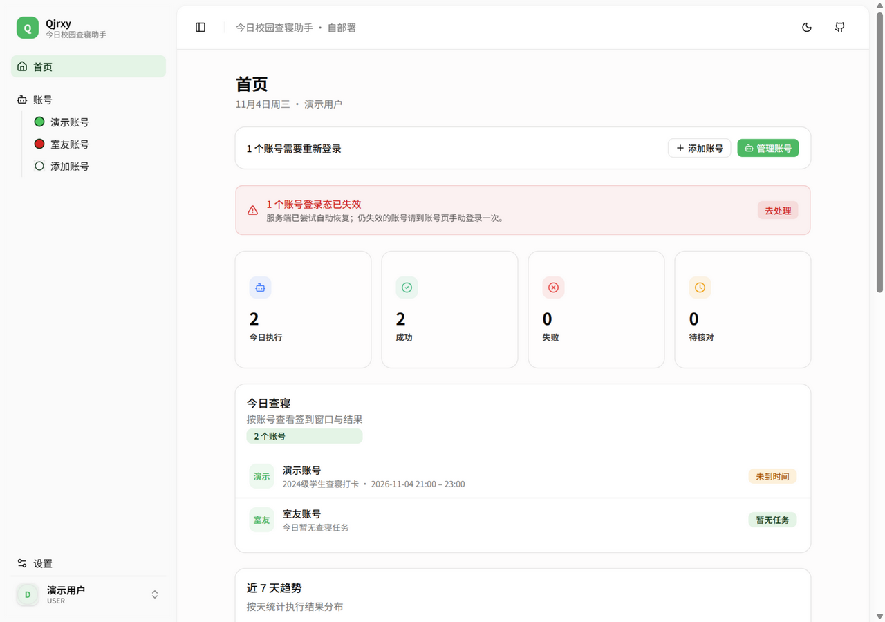

# Qjrxy

今日校园（Campusphere）查寝自动助手 —— 自部署单二进制工具。

绑定账号后，服务端会在查寝时间窗口内自动提交，会话过期自动恢复，全程无需打开 App。

> 本项目**只处理查寝任务**（宿舍考勤），二维码签到类任务不会执行。



## 界面

以下截图使用虚构的演示数据（示例大学 / 演示账号），不含任何真实账号信息。

| 账号管理 | 执行详情 |
| --- | --- |
|  |  |


## 功能

- **自动查寝** — 按计划的星期与时段执行；任务未到时间自动等待，不产生无效提交
- **窗口驱动调度** — 同步一次任务后在本地计算唤醒时刻，不做高频轮询（每账号每天约 2 次请求）
- **会话自愈** — 登录态定期探测，失效时用保存的密码自动重登并同步任务
- **多账号** — 每个账号独立设备指纹，扫码获取真实设备信息，提交特征与 App 一致
- **自动登录** — 账密 AES-256-GCM 加密存储，图形验证码在界面内输入
- **自动定位** — 从学校下发的任务读取签到点与半径，无需手动选点
- **执行记录** — 成功 / 失败 / 待核对分级，7 日趋势，签到点距离可回溯
- **深色模式** · 移动端适配 · 单二进制部署

## 快速开始

### 方式一：下载二进制

从 [Releases](../../releases) 下载对应平台产物，直接运行：

```bash
./qjrxy -addr :8090 -data ./data
```

### 方式二：Docker

```bash
docker build -f deploy/Dockerfile -t qjrxy .
docker run -d -p 8090:8090 -v ./data:/app/data qjrxy
```

### 方式三：源码构建

需要 Go ≥ 1.26、Node ≥ 20：

```bash
make build          # 前端构建 + Go 编译 → bin/qjrxy
./bin/qjrxy -addr :8090 -data ./data
```

> 仓库已提交构建好的 `web/dist`，只改后端时直接 `go build` 即可，无需 node。

## 使用流程

1. 首次访问注册管理员账号（数据全部在你自己的服务器上）
2. **账号页 → 添加账号**：学校（自动匹配）+ 学号 + 密码 → 保存即登录，自动获取签到点
3. 点账号卡片 → **设备 → 扫码绑定设备**（用平时打卡的手机扫，App 右上角「＋」→ 扫一扫）
4. 点账号卡片 → **设备 → 上传照片**（查寝要求照片时必填）
5. 点账号卡片 → **计划 → 新建计划**：选星期与执行方式（跟随学校时间 / 自定义时段）
6. 完成。之后每天到点自动查寝，首页可看状态

## 配置

| 环境变量 | 默认值 | 说明 |
| --- | --- | --- |
| `QINGJIN_ADDR` | `:8090` | 监听地址 |
| `QINGJIN_DATA_DIR` | `./data` | 数据目录（SQLite、照片、密钥） |
| `QINGJIN_SECRET` | 自动生成 | 32 字节密码加密密钥（base64） |
| `QINGJIN_ADMIN_USER` | 空 | 首次启动创建的管理员账号 |
| `QINGJIN_ADMIN_PASS` | 空 | 管理员密码 |
| `QINGJIN_QUOTA_ENABLED` | `false` | 额度/卡密体系开关（托管多用户运营场景才需要） |
| `QINGJIN_REGISTER_OPEN` | `false` | 是否允许自助注册。默认只在库中还没有任何用户时允许（首次初始化），之后注册口自动关闭 |
| `QINGJIN_TLS_INSECURE_HOSTS` | 空 | 允许跳过证书校验的主机后缀，逗号分隔（如 `campusphere.net`）。仅个别学校证书链残缺时才用，默认对全部主机做严格校验 |

> **关于证书校验**：服务器到学校这一跳承载学号与密码，默认做完整证书链校验。
> 若某校入口证书链不完整导致无法登录，用 `QINGJIN_TLS_INSECURE_HOSTS` **精确列出该校域名**，
> 不要整体关闭校验——否则同链路上的任何人都能伪造学校登录页拿到明文密码。

> **关于卡密**：开启 `QINGJIN_QUOTA_ENABLED` 后，卡密是**一次性**的，且必须先在库里预置：
>
> ```bash
> sqlite3 data/qingjin.db "INSERT INTO redeem_codes (code, amount, created_at) \
>   VALUES ('QJ-A1B2-C3D4', 30, strftime('%Y-%m-%dT%H:%M:%S+08:00','now','localtime'));"
> ```
>
> 兑换时才会把 `used_by` 原子占位，未入库或已使用的码一律拒绝。

## 架构

```
Go 后端（单二进制，go:embed 内嵌前端）
├── internal/cpdaily    今日校园协议层（登录 / 任务 / 提交 / 照片上传）
├── internal/scheduler  双循环调度器（计划执行 30s + 登录态探测按需）
├── internal/service    业务层（会话自愈、任务窗口计算、设备绑定）
├── internal/server     HTTP API
└── internal/store      SQLite（modernc.org/sqlite，无 CGO）
前端
└── web/frontend        React 19 + TypeScript + Tailwind v4 + shadcn/ui（Vite 构建）
```

## 开发

```bash
make frontend-dev    # 前端热更新（/api 代理到 :8090）
make build           # 完整构建
make test            # Go 测试
make linux           # 交叉编译 Linux amd64/arm64
```

## 免责声明

本项目仅供个人学习与研究。请使用**本人或已获授权的账号**，遵守学校规定与相关法律法规。
使用本工具产生的一切后果由使用者自行承担。

## 致谢

本项目的协议实现与界面积累自多个开源项目的研究成果。感谢以下作者：

### 界面

- **[OpeniLink Hub](https://github.com/openilink/openilink-hub)**（MIT）— 前端骨架来源。`web/frontend/src/components/ui/` 的 shadcn/ui 组件、侧边栏布局、登录页六边形背景、主题令牌均移植自该项目，并按本项目需求改造（导航收敛为三页、移除微信扫码/Passkey/OAuth 认证通道、补充业务组件）。
- **[shadcn/ui](https://ui.shadcn.com)**（MIT）— 组件体系与 `radix-nova` 风格预设
- **[Radix UI](https://www.radix-ui.com)**（MIT）— 无样式可访问性原语
- **[Geist](https://vercel.com/font)** — 字体（SIL Open Font License）

### 协议实现

- **[CpdailyHelper](https://github.com/YVFENGXS/CpdailyHelper)** — 提交体加密、任务详情解析、位置范围校验
- **[jrxyzuixingnx](https://github.com/maserpoassr/jrxyzuixingnx)** — `getSecretKey` 动态密钥协商、CAS/IAP 登录流程、OBS 照片上传，以及 App 原生加密层的逆向分析文档
- **[campus-device-id](https://github.com/2257929377/campus-device-id)** — `/device.html` 扫码页的 Cordova 桥接方案
- **[qingjin-cpdaily](https://github.com/3238614968/qingjin-cpdaily)** — 早期界面形态与交互参考

### 技术栈

- **Go**：`modernc.org/sqlite`（纯 Go SQLite，无 CGO）、`goquery`（HTML 解析）、`skip2/go-qrcode`（二维码）、`golang.org/x/crypto`（scrypt）
- **前端**：React 19、Vite、Tailwind CSS v4、TanStack Query、zustand、lucide-react

## 声明

本项目与「今日校园」（Campusphere / 江苏金智教育）官方无任何关联，未获其授权或认可。
所有接口调用均由使用者本人的账号发起，本项目不提供任何服务器中转或代登录服务。


## License

[MIT](LICENSE)
