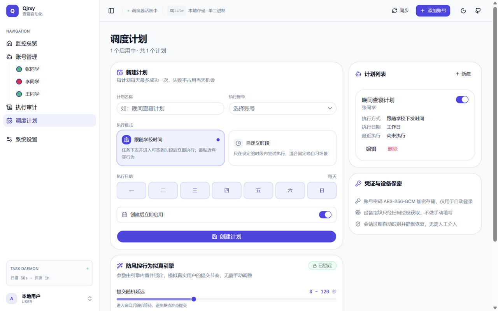
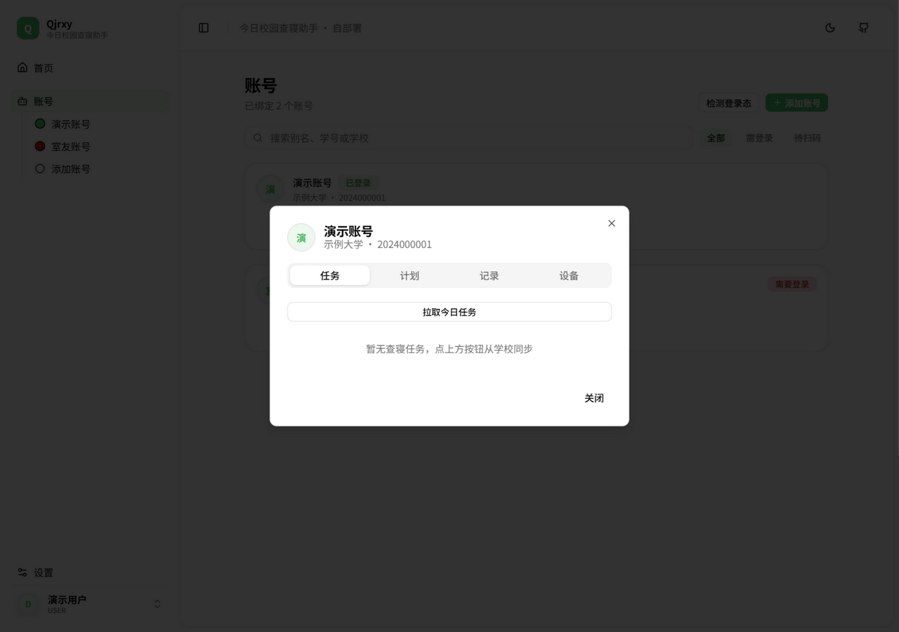

# Qjrxy

今日校园（Campusphere）查寝自动化 —— 开源的 Go 实现，编译为单个可执行文件自行部署。

支持密码、**短信验证码**或**扫码获取登录态**三种方式。托管认证（CLOUD）学校用账密/短信即可；学校自建统一身份认证（NOTCLOUD）可使用今日校园账号绑定手机号的短信验证码登录（首次未下发票据时自动补签），也可用「扫码登录」借 App 已登录的会话换出学校业务会话。绑定账号后，服务端会在查寝时间窗口内自动提交，会话过期自动恢复，全程无需打开 App。

> 本项目**只处理查寝任务**（宿舍考勤），二维码签到类任务不会执行。


## 界面

四个页面：**监控总览 / 账号管理 / 执行审计 / 调度计划**。

以下截图使用虚构的演示数据（示例大学 / 演示账号），不含任何真实账号信息。

| 账号管理 | 调度计划 |
| --- | --- |
|  |  |

| 执行详情 | 执行审计 |
| --- | --- |
|  |  |


## 功能

- **两种运行形态**
  - **单用户模式（默认）**：编译后直接运行即用——自动打开浏览器、跳过登录、注册口关闭；API 仅建议在可信网络使用
  - **多用户模式**：`QINGJIN_MULTI_USER=true` 恢复账号体系（登录 / 注册门 / 会话限流），服务器多人部署用
- **自动查寝** — 按计划的星期或**指定日期**与时段执行；任务未到时间自动等待，不产生无效提交
- **窗口驱动调度** — 同步一次任务后在本地计算唤醒时刻，正常有任务时不做高频轮询；
  确实没有任务时也按分钟级退避重探，不会形成请求风暴
- **短信验证码登录** — 基于今日校园账号体系，验证码渠道自适应（`CPDAILY` / `MOB`）；`sessionToken` 可长期续期
- **扫码获取登录态** — 用已登录今日校园的手机扫一次码，借 App 自身的登录态换出学校业务会话，**不需要密码、不需要走学校统一认证页**；适用于自建认证的 NOTCLOUD 学校。手机页会显示目标学校与学号，核对后再确认绑定
- **学校类型校验** — 选校时即标注认证方式：NOTCLOUD 学校（自建统一身份认证）不走通用账密登录，可用今日校园账号短信验证码或「扫码获取登录态」
- **会话自愈** — 登录态定期探测；优先用 CAS 票（TGC）换票，短信账号可用 `sessionToken` 刷新 TGC；密码账号仍可自动重登
- **照片池** — 每账号最多 10 张、单张 ≤ 5MB，执行时按上传顺序轮换；池优先、单张兜底；管理员可设全局总容量（默认 1GB）
- **账号迁移** — 导出 / 导入 CSV 或 JSON，默认携带 cookies + TGC 登录态（密码可选），换机后免登录继续用
- **多账号** — 每个账号独立设备指纹，扫码获取真实设备信息；扫码拿不到时也支持手动粘贴设备 ID / UA，提交特征与 App 一致
- **自动登录** — 账密 AES-256-GCM 加密存储，图形验证码在界面内输入
- **自动定位** — 从学校下发的任务读取签到点与半径，无需手动选点；也支持用[高德坐标拾取页](https://www.amap.com/ssr/coordinate-picker)手动填写坐标
- **执行审计** — 每次执行带流水号（traceId）、耗时与围栏偏移，支持毫秒级时间线回放、CSV 导出与实时刷新
- **提交确认** — 提交成功后按学校列表延迟轮询正判（以 `signedTasks` 为准），「待核对」会在任务同步时自动回填，不会永久挂起
- **执行记录** — 成功 / 失败 / 待核对分级，7 日趋势，签到点距离可回溯
- **深色模式** · 移动端适配 · 编译后为单个可执行文件（前端已内嵌）

## 快速开始

> **本项目只提供源代码，不提供预编译二进制或部署包。** 需要自行编译，
> 编译产物只在你自己的设备上运行。

### 1. 编译

需要 Go ≥ 1.26。仓库已提交构建好的 `web/dist`，**只改后端时不需要 Node**：

```bash
git clone <本仓库地址> qjrxy && cd qjrxy
make build        # → bin/qjrxy
```

需要重新构建前端时（改了 `web/frontend/`）才装 Node ≥ 20：

```bash
make frontend     # 或在 web/frontend 下 npm install && npm run build
make build
```

其他平台交叉编译：

```bash
make linux        # → bin/qjrxy-linux-amd64 / -arm64
make windows      # → bin/qjrxy.exe
make mac          # → bin/qjrxy-darwin-arm64
```

### 2. 运行

```bash
./bin/qjrxy
```

默认监听 `:8090`，数据落在 `./data`（SQLite + 照片 + 加密密钥）。

- 单用户模式（默认）：打开即用，无需登录；启动后会自动打开浏览器
- 只允许本机访问：`./bin/qjrxy -addr 127.0.0.1:8090`
- 换端口/数据目录：`./bin/qjrxy -addr :9000 -data /path/to/data`

> **单用户模式没有任何鉴权。** 绑定非回环地址时启动日志会打印警告，
> 请只在你能控制的网络里这样用。需要多人使用请见下一节。

### 3. 服务器部署（可选）

多人使用需要开多用户模式，否则所有接口无鉴权暴露：

```bash
QINGJIN_MULTI_USER=true QINGJIN_ADMIN_USER=admin QINGJIN_ADMIN_PASS='强密码' \
  ./bin/qjrxy -addr 127.0.0.1:8090 -data /var/lib/qjrxy/data
```

细节（systemd、反向代理、权限）见 [deploy/README.md](deploy/README.md)。

Docker：

```bash
docker build -f deploy/Dockerfile -t qjrxy .
docker run -d -p 8090:8090 -v ./data:/data qjrxy
```

## 使用流程

程序启动后，浏览器打开 `http://127.0.0.1:8090`（服务器部署则换成服务器地址）。
多用户模式需要先登录。

### 第一步：添加账号

账号页 →「添加账号」→ 输入学校全称（会自动匹配）、学号、密码。

三种登录方式按学校类型选：

| 方式 | 适用 | 说明 |
| --- | --- | --- |
| 账密登录 | 托管认证（CLOUD）学校 | 保存后自动登录；学校要求图形验证码时在界面内输入 |
| 短信验证码 | 两类学校均可 | 用今日校园账号绑定的手机号收码；首次没下发换票凭据时自动补签 |
| 扫码登录 | 自建认证（NOTCLOUD）学校 | 用已登录今日校园的手机扫一次码，不需要密码，也不走学校认证页 |

> 选校时若提示该校「需扫码登录」，说明是 NOTCLOUD 学校，账密/短信走不通，用扫码。

### 第二步：绑定设备

点账号卡片 → **「扫码绑定设备」**：用你平时打卡的那台手机扫二维码
（今日校园 App 右上角「＋」→ 扫一扫）。本机运行要求手机与电脑同一网络；
服务器部署则任意网络均可。

设备指纹决定提交能否被学校接受，**必须用真实打卡的那台手机**。
扫码拿不到时也支持手动粘贴设备 ID / UA。

### 第三步：上传照片（按需）

点账号卡片 →「照片」tab。查寝任务要求照片时必须传，否则提交必失败。

- **照片池**：最多 10 张、单张 ≤ 5MB，执行时按上传顺序轮换
- 池为空时用下方兜底的单张照片
- 同一张照片反复使用容易被识别，建议放几张不同的

### 第四步：确认签到位置

「设置」tab 里检查签到位置。

- 一般点「从学校读取签到点」即可，坐标与半径都来自学校下发的签到点
- 也可用[高德坐标拾取页](https://www.amap.com/ssr/coordinate-picker)取点后粘贴

### 第五步：建自动计划

调度计划页 →「新建计划」：选账号、星期或**指定日期**、执行方式。

- **跟随学校时间**：任务下发并进入可签到时段后自动执行（推荐）
- **自定义时段**：只在设定的时间范围内执行

建好后到点自动提交。任务还没到时间会自动等待，不会产生无效提交。

### 之后看什么

- **监控总览**：今日就绪率、执行流水
- **执行审计**：每次提交的流水号、耗时、距离、失败原因，可按毫秒回放
- **账号详情 →「执行记录」**：单个账号的历史，成功/失败/待核对分级

「待核对」表示提交已发出但学校列表还没更新，系统会在后续同步时自动核实并回填，
不需要手动重试。

## 配置

| 环境变量 | 默认值 | 说明 |
| --- | --- | --- |
| `QINGJIN_MULTI_USER` | `false` | **多用户模式开关**。默认单用户直开（无鉴权）；服务器多人部署必须设 `true` |
| `QINGJIN_ADDR` | `:8090` | 监听地址。配合 Nginx 反代建议设 `127.0.0.1:8090` |
| `QINGJIN_DATA_DIR` | `./data` | 数据目录（SQLite、照片、密钥） |
| `QINGJIN_NO_OPEN` | `false` | 设 `1` 关闭单用户模式启动后自动打开浏览器 |
| `QINGJIN_SECRET` | 自动生成 | 32 字节密码加密密钥（base64） |
| `QINGJIN_ADMIN_USER` | 空 | 首次启动创建的管理员账号（多用户模式） |
| `QINGJIN_ADMIN_PASS` | 空 | 管理员密码 |
| `QINGJIN_REGISTER_OPEN` | `false` | 是否允许自助注册。默认只在库中还没有任何用户时允许（首次初始化），之后注册口自动关闭 |
| `QINGJIN_TLS_INSECURE_HOSTS` | 空 | 允许跳过证书校验的主机后缀，逗号分隔（如 `campusphere.net`）。仅个别学校证书链残缺时才用，默认对全部主机做严格校验 |

> **关于单用户模式**：所有接口自动落到唯一的本地用户（老数据库会复用第一个用户，数据无缝迁移），
> 无登录无注册，API 无鉴权——这是「双击就能用」的代价。请仅在可信网络使用；
> 绑定非回环地址时启动日志会打印警告。

> **关于证书校验**：服务器到学校这一跳承载学号与密码，默认做完整证书链校验。
> 若某校入口证书链不完整导致无法登录，用 `QINGJIN_TLS_INSECURE_HOSTS` **精确列出该校域名**，
> 不要整体关闭校验——否则同链路上的任何人都能伪造学校登录页拿到明文密码。

## 架构

```
Go 后端（单二进制，go:embed 内嵌前端）
├── internal/cpdaily    今日校园协议层（账密/短信登录、任务、提交、照片上传）
├── internal/scheduler  双循环调度器（计划执行 30s + 登录态探测按需）
├── internal/service    业务层（会话自愈、TGC/sessionToken 续期、扫码登录票据、照片池、任务窗口计算）
├── internal/server     HTTP API（账号导入导出、扫码登录、照片池、执行审计、局域网地址探测）
└── internal/store      SQLite（modernc.org/sqlite，无 CGO；账号/任务/计划/照片池）
前端
└── web/frontend        React 19 + TypeScript + Tailwind v4 + shadcn/ui（Vite 构建）
```

## 开发

```bash
make test            # Go 测试
make vet             # go vet
make build           # 只编译后端（前端用已提交的 web/dist）
make frontend        # 重新构建前端 → web/dist，之后再 make build
make frontend-dev    # 前端热更新，/api 代理到 :8090（需同时跑 make run）
make linux           # 交叉编译 Linux amd64/arm64
```

> 改了 `web/frontend/` 之后必须跑 `make frontend`，否则二进制里仍是旧前端
> （`web/dist` 由 go:embed 编进去，不重新构建不会更新）。

## 免责声明

本项目按「现状」提供，不附任何明示或默示担保。请在符合所在学校规定与当地法律法规的
前提下使用，并仅用于**本人所有**或**已获授权**的账号。
详细的使用范围与免责条款见文末[「声明」](#声明)一节。

## 致谢

本项目的界面与协议实现参考了以下开源项目，感谢这些作者公开分享的工作：

### 界面

- **[OpeniLink Hub](https://github.com/openilink/openilink-hub)**（MIT）— 前端骨架来源。`web/frontend/src/components/ui/` 的 shadcn/ui 组件、侧边栏布局、登录页六边形背景、主题令牌均移植自该项目，并按本项目需求改造（导航收敛为监控总览 / 账号管理 / 执行审计 / 调度计划四页、移除微信扫码/Passkey/OAuth 认证通道、补充业务组件）。
- **[shadcn/ui](https://ui.shadcn.com)**（MIT）— 组件体系与 `radix-nova` 风格预设
- **[Radix UI](https://www.radix-ui.com)**（MIT）— 无样式可访问性原语
- **[Geist](https://vercel.com/font)** — 字体（SIL Open Font License）

### 协议实现

本项目的网络协议实现参考了下列公开研究项目所公布的文档与分析。
这些资料帮助理解了设备端与服务器之间的交互方式，在此致谢。

- **[jrxyzuixingnx](https://github.com/maserpoassr/jrxyzuixingnx)**（Python，MPL-2.0）— 公开的协议研究，描述了 `getSecretKey` 密钥派生与安卓端请求契约。
- **[CpdailyHelper](https://github.com/YVFENGXS/CpdailyHelper)** — 公开项目，其文档用于核对提交体加密方式、任务详情字段与位置范围校验的语义。
- **[campus-device-id](https://github.com/2257929377/campus-device-id)** — 公开的 `/device.html` 扫码页 Cordova 桥接方案。
- **[qingjin-cpdaily](https://github.com/3238614968/qingjin-cpdaily)** — 早期同类实现，界面形态与交互方式曾参考该项目。

> **说明**：上述项目均为独立的第三方研究，彼此之间没有隶属或合作关系。
> 它们的作者未参与本项目开发，也未对本项目作出任何形式的承诺或背书。
> 本项目与它们之间仅为公开资料层面的参考关系。
> 若任一项目的作者认为本文档中的致谢方式不妥，请通过项目页告知，我们会及时调整表述。

### 技术栈

- **Go**：`modernc.org/sqlite`（纯 Go SQLite，无 CGO）、`goquery`（HTML 解析）、`skip2/go-qrcode`（二维码）、`golang.org/x/crypto`（scrypt）
- **前端**：React 19、Vite、Tailwind CSS v4、TanStack Query、zustand、lucide-react

## 声明

**与官方的关系**：本项目与「今日校园」（Campusphere / 江苏金智教育）及其关联公司无任何关联，
未获其授权、认可或技术支持。项目名称、协议实现与界面设计均不代表官方立场。

**本项目是什么**：一份以源代码形式发布的、供学习与个人自部署使用的技术实现。
本项目不针对任何特定学校、任何特定个体，也不替代任何官方渠道。

**本项目不提供什么**：

- **不提供部署好的服务、不提供部署包或预编译二进制**。仓库仅包含源代码，
  由使用者自行阅读、编译与部署，且仅限在其本人控制的设备上运行。
- **不提供服务器中转、不代登录、不代签到**。本项目没有任何云端中转节点，
  不收集、不上传任何账号数据；所有请求都由使用者本机直接发往学校服务器。
- **不提供任何形式的账号代管服务**，也不受理他人的账号委托。

**使用限制**：

- 仅限使用**本人所有**或**已取得明确书面授权**的账号。
- 使用前请自行确认不违反所在学校的校规校纪及当地法律法规。
- **禁止**将本项目用于代他人签到、批量代管他人账号、对外提供签到服务等用途。
- 作者不支持、不鼓励、也不参与上述任何用途。

**免责**：本项目按「现状」（AS IS）提供，不附任何明示或默示的担保，包括但不限于
适销性、特定用途适用性与不侵权的担保。在法律允许的最大范围内，项目作者与贡献者
不对使用或无法使用本项目所造成的任何直接、间接、偶然或后果性损失承担责任。
使用者应在使用前自行评估其所在学校的规定与当地法律法规的要求，
并对自己的使用行为负责。

**关于第三方成果**：上文致谢中列出的项目均为独立的第三方研究，
其作者未参与本项目开发，也未为本项目作出任何承诺或背书。

## License

本项目以 [GNU Affero General Public License v3.0](LICENSE)（AGPL-3.0）发布。

简单的说：

- **自己用、自己改、自己部署**：随便用，不需要告知任何人。
- **分发或对外提供服务**：必须公开你修改后的完整源代码，并以同一协议授权。
- **不提供任何担保**。

本项目是一项免费的开源项目。选择 AGPL-3.0 而不是更宽松的协议，是为了让这份代码
及其后续改进持续保持开源：AGPL 第 13 条要求通过网络对外提供服务时也必须公开源代码，
这与本项目「免费开源、改进回馈社区」的定位一致。
